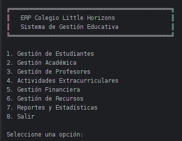
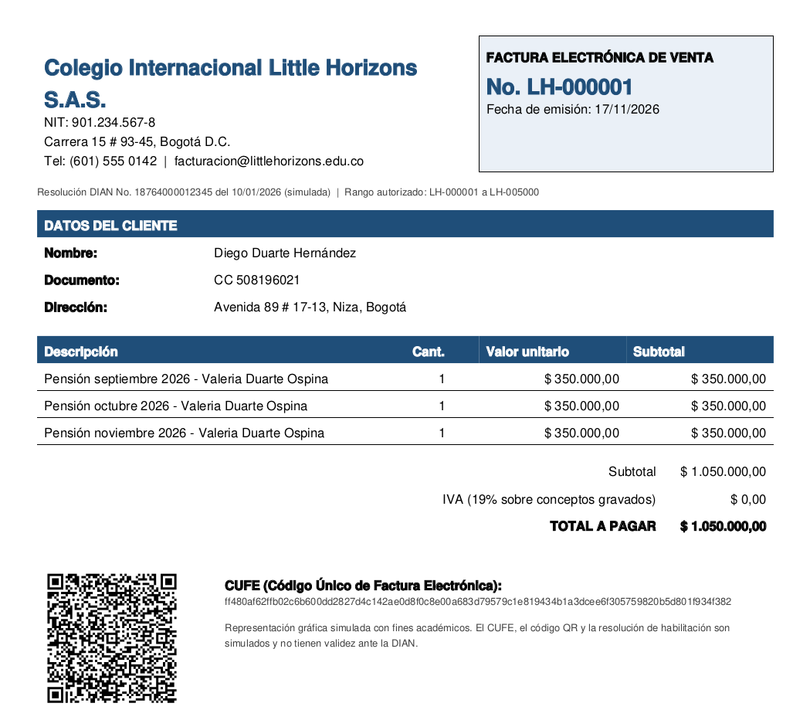

# 🎓 ERP Colegio Internacional "Little Horizons"

Sistema de Planificación de Recursos Empresariales (ERP) educativo, de consola, desarrollado en **Java** con **MySQL**, que centraliza la gestión académica, extracurricular, financiera y de recursos de un colegio.

---

## 1. Descripción

### Propósito
"Little Horizons" atiende a más de 500 estudiantes y 40 profesores, y su información vivía en cuadernos y hojas de cálculo dispersas. Este sistema reemplaza esos registros por una aplicación única, con una base de datos relacional y reglas de negocio validadas.

### Problemas que resuelve
| Problema | Solución en el sistema |
|---|---|
| Notas perdidas en cuadernos | Registro de calificaciones en base de datos con historial completo desde el ingreso |
| Actividades extracurriculares sin control | Catálogo de clubes con cupos, membresías y registro de participantes en eventos |
| Facturación manual y propensa a errores | Cargos, pagos y **factura electrónica en PDF** (CUFE y QR simulados) |
| Libros y equipos que se "pierden" | Inventario con préstamos, devoluciones y reporte de vencidos |
| Profesores sin visibilidad del rendimiento | Promedios automáticos y reporte de estudiantes que necesitan apoyo |

### Funcionalidades principales
Gestión de estudiantes y acudientes · Matrícula por grado · Inscripción en materias · Profesores con horarios sin choques · Notas y promedios · Asistencia e inasistencias · Clubes y eventos · Conceptos de pago, cargos, pagos y morosos · Facturas PDF · Recursos y préstamos · Reportes y estadísticas.

---

## 2. Autores

| Campo | Dato |
|---|---|
| Nombre completo | Yeison Alberto Vargas Serrano |
| Correo electrónico | yavargas.iecrp2023@gmail.com |
| Contacto | GitHub: https://github.com/yeisonvargas9 |

---

## 3. Tecnologías utilizadas

| Categoría | Tecnología |
|---|---|
| Lenguaje | Java 17 o superior (compilado con `release 17`; probado en JDK 21) |
| IDE | IntelliJ IDEA |
| Construcción | Apache Maven 3.8+ |
| Base de datos | MySQL 8.0 o superior |
| Driver JDBC | MySQL Connector/J 8.4.0 |
| Librerías externas | **OpenPDF 1.3.30** (generación de PDF) y **ZXing core 3.5.3** (código QR) |
| Control de versiones | Git y GitHub |

---

## 4. Requerimientos previos

- **JDK 17 o superior**
- **Apache Maven 3.8+** (incluido en IntelliJ IDEA)
- **MySQL 8.0 o superior** — ⚠️ **obligatorio**: el esquema usa restricciones `CHECK`, que solo se aplican correctamente desde la versión 8.0.16.
- Conexión a internet la primera vez, para que Maven descargue las dependencias.
- Un cliente SQL (DBeaver, MySQL Workbench o la línea de comandos `mysql`).

---

## 5. Configuración de la base de datos

### 5.1 Creación de la base de datos
El script `docs/database.sql` **crea la base `erp_little_horizons`, todas sus tablas y los datos de prueba**. No hay que crear nada a mano.

- **DBeaver:** abrir el archivo en un editor SQL y ejecutarlo como script (**Alt + X**).
- **Línea de comandos:** `mysql -u TU_USUARIO -p < docs/database.sql`

> ⚠️ El script empieza con `DROP DATABASE IF EXISTS erp_little_horizons`: si se ejecuta de nuevo, recrea la base desde cero.

### 5.2 Configuración de credenciales
1. Copiar `db.properties.example` y nombrar la copia **`db.properties`** (misma carpeta que `pom.xml`).
2. Completar los datos:
```properties
db.url=jdbc:mysql://localhost:3306/erp_little_horizons?useSSL=false&allowPublicKeyRetrieval=true&serverTimezone=America/Bogota
db.user=tu_usuario
db.password=tu_contraseña
```
El archivo `db.properties` está en `.gitignore`: **las credenciales no se suben al repositorio**.

### 5.3 Instalación del driver JDBC
Es automática: Maven descarga `mysql-connector-j` desde el `pom.xml`. No hay que copiar ningún `.jar`.

### Cambios al esquema del anexo
El script parte del esquema proporcionado (v2.0) y agrega mejoras justificadas, documentadas al inicio de `docs/database.sql`: columnas sin la letra «ñ» (`anio_academico`), tipo de documento `RC`, y las tablas nuevas `horarios_clase`, `valores_concepto_estudiante`, `cargos`, `detalle_factura` y `configuracion_colegio`, necesarias para cumplir los requisitos de horarios, valores personalizados, morosos y facturas con varios conceptos.

### Datos de prueba incluidos
| Tabla | Registros | | Tabla | Registros |
|---|---|---|---|---|
| estudiantes | 32 | | profesores | 32 |
| acudientes | 34 | | materias | 48 |
| registros_academicos | 472 | | pagos | 151 |
| clubes | 30 | | recursos | 40 |

Incluyen casos para probar los reportes: 5 morosos, 3 estudiantes con inasistencias repetidas, préstamos vencidos y hermanos con descuento.

---

## 6. Instalación y ejecución

### 6.1 Clonar el repositorio
```bash
git clone https://github.com/yeisonvargas9/little-horizons-erp.git
cd little-horizons-erp
```
### 6.2 Abrir el proyecto en el IDE
En IntelliJ IDEA: **File → Open** y seleccionar el `pom.xml`. Esperar a que Maven descargue las dependencias (o clic derecho sobre el proyecto → **Maven → Reload project**).

### 6.3 Compilar
```bash
mvn clean compile
```
### 6.4 Ejecutar
- **Desde el IDE:** ejecutar la clase `com.littlehorizons.erp.Main`.
- **Desde la terminal (opcional):**
```bash
mvn org.codehaus.mojo:exec-maven-plugin:3.1.0:java -Dexec.mainClass=com.littlehorizons.erp.Main
```
Al ejecutar desde la raíz del proyecto, los archivos `error_log.txt` y la carpeta `invoices/` se crean ahí.

---

## 7. Estructura del proyecto

```
little-horizons-erp/
├── pom.xml
├── db.properties.example
├── README.md
├── docs/
│   └── database.sql                  ← DDL + DML
└── src/main/java/com/littlehorizons/erp/
    ├── Main.java                     ← punto de entrada y ensamblaje de dependencias
    ├── model/                        ← entidades, enums y records
    ├── view/                         ← interfaces de consola (menús)
    ├── controller/                   ← lógica de negocio y validaciones
    ├── dao/                          ← interfaces de acceso a datos
    │   └── impl/                     ← implementaciones JDBC
    ├── util/                         ← conexión, logs, validaciones, PDF, entrada de consola
    └── exception/                    ← excepciones propias
```

### Arquitectura MVC
Cada capa tiene una única responsabilidad y solo habla con la siguiente:

```
 Vista (view)  ──►  Controlador (controller)  ──►  DAO (dao/impl)  ──►  MySQL
 pregunta y muestra   valida reglas de negocio       ejecuta el SQL
        ▲                                             │
        └──────────── Modelo (model) ◄────────────────┘
```

| Paquete | Descripción |
|---|---|
| `model` | Entidades del dominio (`Student`, `Guardian`, `Professor`...), enums que traducen a la base de datos y `records` inmutables (`Invoice`, `Loan`, `Charge`...) |
| `view` | `MainMenuView` y una vista por módulo. Solo entrada/salida, **sin reglas de negocio ni SQL** |
| `controller` | `StudentController`, `ProfessorController`, `AcademicController`, `FinanceController`, `ExtracurricularController`, `ResourceController`, `ReportController` |
| `dao` / `dao.impl` | Una interfaz por conjunto de datos y su implementación JDBC. Todo el SQL vive aquí |
| `util` | `DatabaseConnection`, `SqlExecutor`, `AppLogger`, `ConsoleInput`, `Validator`, `PdfInvoiceRenderer` |
| `exception` | `BusinessException`, `DataAccessException`, `OperationCancelledException` |

---

## 8. Principios y patrones de diseño aplicados

### 8.1 Principios SOLID

**S — Responsabilidad única.** Cada clase hace una sola cosa: `Validator` solo valida formatos; `StudentView` solo interactúa con el usuario; `StudentController` aplica las reglas; `StudentDaoImpl` ejecuta el SQL.

**O — Abierto/cerrado.** Se puede agregar un módulo o un formato de factura nuevo sin modificar el código existente. Por ejemplo, un generador de facturas en HTML se crea implementando `InvoiceRenderer`, sin tocar `FinanceController`.

**L — Sustitución de Liskov.** Cualquier implementación de `StudentDao` puede reemplazar a `StudentDaoImpl` sin que el controlador lo note (por ejemplo, una versión en memoria para pruebas).

**I — Segregación de interfaces.** Las interfaces son pequeñas y específicas: `SubjectDao` solo tiene métodos de lectura (el catálogo de materias no se modifica), y `GuardianDao` no obliga a implementar lo que no usa.

**D — Inversión de dependencias.** Los controladores dependen de **interfaces**, no de clases concretas, y las reciben por el constructor:
```java
StudentDao studentDao = new StudentDaoImpl(database);
StudentController studentController = new StudentController(studentDao, guardianDao);
```
`FinanceController` recibe un `InvoiceRenderer` (interfaz) y no conoce la librería de PDF.

### 8.2 Patrones de diseño

| Patrón | Dónde | Justificación |
|---|---|---|
| **MVC** | Toda la aplicación | Separa interfaz, reglas y datos |
| **DAO** | `dao` y `dao.impl` | Aísla el SQL; cambiar de base de datos solo afecta esta capa |
| **Singleton** | `DatabaseConnection` (idiom *holder*, seguro con hilos) | La configuración se lee una sola vez y se comparte |
| **Inyección de dependencias** | `Main` | Los objetos reciben sus colaboradores; facilita pruebas y cambios |
| **Strategy** | `InvoiceRenderer` / `PdfInvoiceRenderer` | Permite cambiar la forma de generar facturas |
| **Template / callbacks** | `SqlExecutor` (`Binder`, `RowMapper`) | Elimina el código JDBC repetido |
| **Value Object / Records** | `ScheduleSlot`, `Invoice`, `Loan`... | Datos inmutables y seguros |

### 8.3 Otras prácticas de calidad
- **`PreparedStatement` en todas las consultas** (previene inyección SQL) y **`try-with-resources`** para cerrar conexiones.
- **Transacciones** donde varias operaciones deben ir juntas: registrar estudiante + acudiente, pago + cargo + factura, préstamo + estado del recurso.
- **Lambdas y Stream API** en filtros, agrupaciones y promedios (`groupingBy`, `averagingDouble`, `flatMap`, `reduce`, `sorted`).
- **`BigDecimal`** para notas y dinero, sin errores de redondeo.
- Código en **inglés** con convenciones estándar de Java.

---

## 9. Funcionalidades principales

El menú principal tiene 8 opciones:

| # | Módulo | Funcionalidades |
|---|---|---|
| 1 | **Estudiantes** | Registro con acudiente (en una transacción), listado, búsqueda por nombre/documento, actualización de contacto y salud, cambio de estado, ver acudientes, resumen por estado |
| 2 | **Académico** | Matrícula por grado (con reglas de promoción), inscripción en materias por período, registro/corrección de notas, boletín con promedios por materia y por período, historial completo, promedio del curso, asistencia diaria por clase, reporte de más de 3 inasistencias semanales |
| 3 | **Profesores** | Registro, actualización, estados, catálogo de materias, asignación de materias con **horario sin choques** (profesor y grupo), carga académica y horario semanal |
| 4 | **Extracurriculares** | Clubes con cupo máximo (validado de forma atómica), inscripción y retiro, miembros, calendario de eventos, participantes con posiciones (1.º, 2.º, 3.º) |
| 5 | **Financiero** | Catálogo de conceptos, valores personalizados (hermanos/becas), cargos, pago de varios cargos, **factura PDF**, historial por estudiante y por acudiente, **morosos** (>1 mes), regenerar PDF |
| 6 | **Recursos** | Inventario con filtros, préstamos a estudiantes y profesores (límites y reglas), devoluciones, préstamos vencidos |
| 7 | **Reportes** | Resumen general, estudiantes por grado, estudiantes que necesitan apoyo (<3.0), mejores promedios, recaudo por concepto, participación extracurricular, estado de recursos |
| 8 | **Salir** | |

**Experiencia de uso:** todas las entradas se validan y se repiten hasta ser correctas; los mensajes usan ✔ (éxito), ⚠ (regla de negocio) y ✖ (error técnico); y se escribe **`cancelar`** en cualquier pregunta para volver al menú anterior.

### Factura electrónica (PDF)
Al confirmar un pago el sistema recopila los datos, calcula el IVA (los precios lo incluyen; solo los conceptos gravados lo desglosan), genera el número consecutivo (`LH-000001`), el **CUFE simulado** (hash SHA-384) y un **QR real (ZXing)**, y guarda el PDF como `invoices/factura_000001.pdf`. La resolución DIAN, el CUFE y el QR son **simulados** y no tienen validez fiscal.

---

## 10. Manejo de errores y logs

**Sistema de logging:** `AppLogger` usa `java.util.logging` y escribe en **`error_log.txt`** (en la carpeta desde donde se ejecuta, normalmente la raíz del proyecto). Cada línea lleva fecha, nivel y mensaje; los errores incluyen el *stack trace* completo.
```
[2026-11-17 10:32:05] SEVERE - SQL failed: SELECT ...
```
**Estrategia de excepciones:**
- Los DAO atrapan `SQLException`, la **registran en el log** y lanzan `DataAccessException` (sin detalles técnicos para el usuario).
- Los controladores lanzan `BusinessException` con un mensaje claro cuando se incumple una regla.
- Las vistas atrapan ambas y muestran el mensaje; el usuario nunca ve un *stack trace*.
- `Main` tiene un último `catch` para errores inesperados.
- Las transacciones hacen `rollback` si algo falla.

---

## 11. Capturas de pantalla (opcional)




---

## 12. Problemas conocidos y limitaciones

- Los pagos son por el valor completo del cargo (no hay abonos parciales).
- La factura, el CUFE, el QR y la resolución DIAN son simulados.
- No hay autenticación de usuarios ni roles.
- El año académico se toma del año actual del sistema.
- Las materias se asignan a la sección "A" por defecto en la inscripción.

## 13. Futuras mejoras

- Abonos parciales y plan de pagos.
- Inicio de sesión con roles (administrador, profesor, tesorería).
- Pruebas unitarias con JUnit y base de datos de prueba.
- Pool de conexiones (HikariCP).
- Exportar reportes a Excel/CSV y envío de facturas por correo.
- Interfaz gráfica o web (por ejemplo, con Spring Boot).

## 14. Licencia

Proyecto académico distribuido bajo licencia **MIT** (ver archivo `LICENSE`).

## 15. Contacto

Yeison Alberto Vargas Serrano — yavargas.iecrp2023@gmail.com

